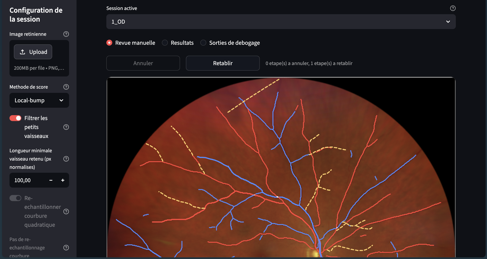

# Tortuosité rétine

A Streamlit app that measures how tortuous (twisty) the blood vessels are in retinal fundus images.

It segments the arteries and veins of an eye, lets you review and correct the detected vessels, then computes a tortuosity score per vessel and per eye. Results can be exported as CSV/Excel files and PDF reports.



## Getting started

You need [uv](https://docs.astral.sh/uv/) and Python 3.11.

```bash
uv sync
uv run streamlit run tortuosite_score/app/app.py
```

The app opens in your browser.

To use the deep-learning segmentation backends (DCP / VascX), install the extra dependencies instead:

```bash
uv sync --extra deep
```

## Credits

The scoring methods prefixed with **Toolkit —** in the app come from [coconetlero/tortuosity_metrics_python](https://github.com/coconetlero/tortuosity_metrics_python).
